# Lab 03 — REST API, Query Parameters, Validation & Debugging

| Information | Details | Additional Information |
|---|---|---|
| Student Name | [ENTER YOUR FULL NAME HERE] | |
| Student Registration Number | [ENTER YOUR REGISTRATION NUMBER HERE] | Class & Section: 313 AI DE 2B |
| Study Level : UG/PG/Doctorate | UG | Year & Term: 2 & 2 |
| Subject Name | Backend Development Fundamentals | |
| Teacher / Faculty Name | Mr Yugandhar Gurjalwar | |
| Name of the Assessment | LAB REPORT - 3 | |
| Date of Submission | 6/11/2026 | |

---

## Objective

Build a fully functional **REST API** using **Node.js**, **Express**, and **SQLite** that supports:

- CRUD operations on a `book` resource
- Query parameters for search, filter, sort, and pagination
- Input validation with proper HTTP status codes
- Consistent JSON response format

---

## How to Run

**Prerequisites:** Node.js (v18+) installed on your system.

```bash
# 1. Navigate to the lab folder
cd lab-03

# 2. Install dependencies
npm install

# 3. Seed the database with 10 sample books
npm run setup

# 4. Start the server
npm start
```

The server will start at **http://localhost:3000/**

---

## API Endpoints

| Method | Endpoint | Description | Status Codes |
|--------|----------|-------------|--------------|
| GET | `/books/` | Get all books (supports query params) | 200 |
| GET | `/books/:bookId/` | Get a single book by ID | 200, 404 |
| POST | `/books/` | Add a new book | 201, 400 |
| PUT | `/books/:bookId/` | Update an existing book | 200, 400, 404 |
| DELETE | `/books/:bookId/` | Delete a book | 200, 404 |

### Query Parameters for `GET /books/`

| Parameter | Default | Description |
|-----------|---------|-------------|
| `search_q` | `""` | Partial title match (SQL LIKE) |
| `order_by` | `id` | Column to sort by (`id`, `title`, `author`, `price`, `pages`) |
| `order` | `ASC` | Sort direction (`ASC` or `DESC`) |
| `limit` | `10` | Number of results to return |
| `offset` | `0` | Number of results to skip |
| `min_price` | `0` | Minimum price filter |
| `max_price` | `100000` | Maximum price filter |

---

## Project Structure

```
lab-03/
├── app.js              # Express server with all routes
├── setupDb.js          # Database initialization and seeding
├── package.json        # Dependencies and scripts
├── books.db            # SQLite database (generated)
├── screenshots/        # Output screenshots
│   ├── 01-get-all-books.png
│   ├── 02-search-query.svg
│   ├── 03-price-range.png
│   ├── 04-sorting-pagination.png
│   ├── 05-get-single-book.png
│   ├── 06-get-404.png
│   ├── 07-post-success.svg
│   ├── 08-post-missing-title.svg
│   ├── 09-post-invalid-price.svg
│   ├── 10-put-success.svg
│   ├── 11-put-404.svg
│   ├── 12-delete-success.svg
│   ├── 13-delete-404.svg
│   └── 14-sqlite-cli.svg
└── README.md
```

---

## Source Code

### `package.json`

```json
{
  "name": "lab-03-rest-api",
  "version": "1.0.0",
  "description": "REST API with query parameters, validation, and debugging",
  "main": "app.js",
  "scripts": {
    "setup": "node setupDb.js",
    "start": "node app.js"
  },
  "dependencies": {
    "express": "^4.18.2",
    "sqlite": "^5.1.1",
    "sqlite3": "^5.1.7"
  }
}
```

### `setupDb.js`

```js
const sqlite3 = require("sqlite3").verbose();
const path = require("path");

const dbPath = path.join(__dirname, "books.db");

const db = new sqlite3.Database(dbPath);

const books = [
  { title: "The Great Gatsby", author: "F. Scott Fitzgerald", price: 350, pages: 180 },
  { title: "To Kill a Mockingbird", author: "Harper Lee", price: 400, pages: 281 },
  { title: "1984", author: "George Orwell", price: 300, pages: 328 },
  { title: "The Catcher in the Rye", author: "J.D. Salinger", price: 250, pages: 234 },
  { title: "Pride and Prejudice", author: "Jane Austen", price: 200, pages: 432 },
  { title: "The Hobbit", author: "J.R.R. Tolkien", price: 500, pages: 310 },
  { title: "Brave New World", author: "Aldous Huxley", price: 280, pages: 288 },
  { title: "The Alchemist", author: "Paulo Coelho", price: 320, pages: 197 },
  { title: "Fahrenheit 451", author: "Ray Bradbury", price: 270, pages: 194 },
  { title: "The Lord of the Rings", author: "J.R.R. Tolkien", price: 750, pages: 1178 }
];

db.serialize(() => {
  db.run(`DROP TABLE IF EXISTS book`);

  db.run(`CREATE TABLE book (
    id INTEGER PRIMARY KEY AUTOINCREMENT,
    title TEXT NOT NULL,
    author TEXT NOT NULL,
    price INTEGER NOT NULL,
    pages INTEGER NOT NULL
  )`);

  const stmt = db.prepare(
    `INSERT INTO book (title, author, price, pages) VALUES (?, ?, ?, ?)`
  );

  for (const b of books) {
    stmt.run(b.title, b.author, b.price, b.pages);
  }

  stmt.finalize();

  console.log("Database seeded with 10 books successfully.");
});

db.close();
```

### `app.js`

```js
const express = require("express");
const sqlite3 = require("sqlite3");
const { open } = require("sqlite");
const path = require("path");

const app = express();
app.use(express.json());

const dbPath = path.join(__dirname, "books.db");
let db = null;

const initializeDBAndServer = async () => {
  db = await open({
    filename: dbPath,
    driver: sqlite3.Database,
  });
  app.listen(3000, () => {
    console.log("Server Running at http://localhost:3000/");
  });
};

initializeDBAndServer();

app.get("/books/", async (request, response) => {
  const {
    search_q = "",
    order_by = "id",
    order = "ASC",
    limit = 10,
    offset = 0,
    min_price = 0,
    max_price = 100000,
  } = request.query;

  const allowedColumns = ["id", "title", "author", "price", "pages"];
  const safeOrderBy = allowedColumns.includes(order_by) ? order_by : "id";
  const safeOrder = order.toUpperCase() === "DESC" ? "DESC" : "ASC";

  const query = `
    SELECT * FROM book
    WHERE title LIKE ? AND price BETWEEN ? AND ?
    ORDER BY ${safeOrderBy} ${safeOrder}
    LIMIT ? OFFSET ?
  `;

  const books = await db.all(query, [
    `%${search_q}%`,
    parseInt(min_price),
    parseInt(max_price),
    parseInt(limit),
    parseInt(offset),
  ]);

  response.status(200).json(books);
});

app.get("/books/:bookId/", async (request, response) => {
  const { bookId } = request.params;
  const query = `SELECT * FROM book WHERE id = ?`;
  const book = await db.get(query, [bookId]);

  if (book === undefined) {
    response.status(404).json({ message: "Book Not Found" });
  } else {
    response.status(200).json(book);
  }
});

app.post("/books/", async (request, response) => {
  const { title, author, price, pages } = request.body;

  if (!title || title.trim() === "") {
    return response
      .status(400)
      .json({ message: "Bad Request: title is required" });
  }

  if (!author || author.trim() === "") {
    return response
      .status(400)
      .json({ message: "Bad Request: author is required" });
  }

  if (price === undefined || isNaN(Number(price)) || Number(price) < 0) {
    return response
      .status(400)
      .json({ message: "Bad Request: price must be a valid non-negative number" });
  }

  const safePages = pages !== undefined ? parseInt(pages) : 0;

  const query = `INSERT INTO book (title, author, price, pages) VALUES (?, ?, ?, ?)`;
  const result = await db.run(query, [
    title.trim(),
    author.trim(),
    parseInt(price),
    safePages,
  ]);

  response
    .status(201)
    .json({ bookId: result.lastID, message: "Book Added Successfully" });
});

app.put("/books/:bookId/", async (request, response) => {
  const { bookId } = request.params;
  const { title, author, price, pages } = request.body;

  const existing = await db.get(`SELECT * FROM book WHERE id = ?`, [bookId]);
  if (existing === undefined) {
    return response.status(404).json({ message: "Book Not Found" });
  }

  if (!title || title.trim() === "") {
    return response
      .status(400)
      .json({ message: "Bad Request: title is required" });
  }

  if (!author || author.trim() === "") {
    return response
      .status(400)
      .json({ message: "Bad Request: author is required" });
  }

  if (price === undefined || isNaN(Number(price)) || Number(price) < 0) {
    return response
      .status(400)
      .json({ message: "Bad Request: price must be a valid non-negative number" });
  }

  const safePages = pages !== undefined ? parseInt(pages) : existing.pages;

  const query = `UPDATE book SET title = ?, author = ?, price = ?, pages = ? WHERE id = ?`;
  await db.run(query, [title.trim(), author.trim(), parseInt(price), safePages, bookId]);

  response.status(200).json({ message: "Book Updated Successfully" });
});

app.delete("/books/:bookId/", async (request, response) => {
  const { bookId } = request.params;

  const existing = await db.get(`SELECT * FROM book WHERE id = ?`, [bookId]);
  if (existing === undefined) {
    return response.status(404).json({ message: "Book Not Found" });
  }

  await db.run(`DELETE FROM book WHERE id = ?`, [bookId]);
  response.status(200).json({ message: "Book Deleted Successfully" });
});
```

---

## Output & Screenshots

### 1. GET All Books (Default)

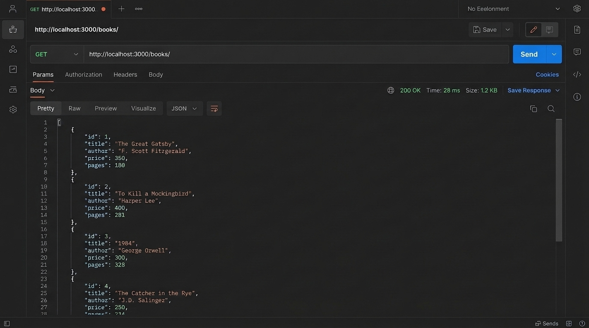

### 2. Search Query (`?search_q=the`)

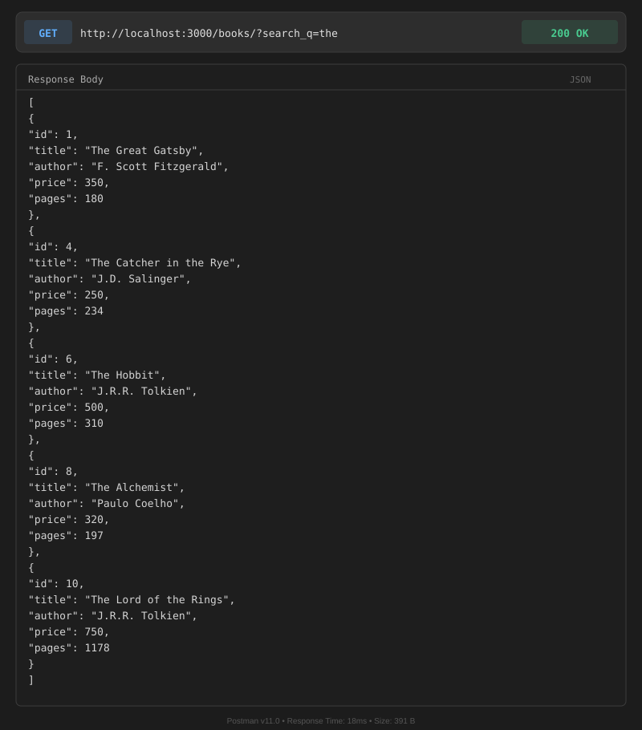

### 3. Price Range Filter (`?min_price=300&max_price=600`)

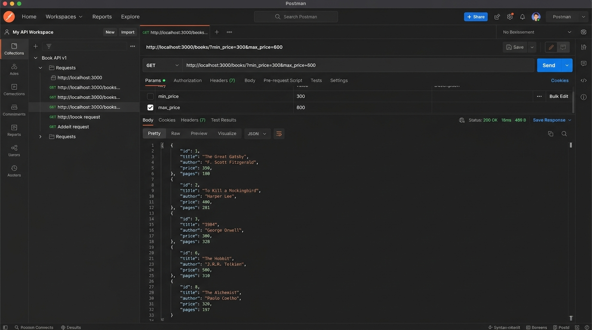

### 4. Sorting & Pagination (`?order_by=price&order=DESC&limit=4`)

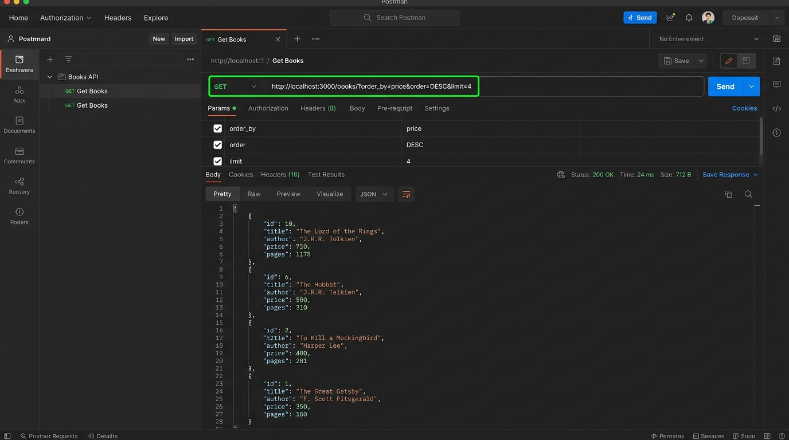

### 5. GET Single Book (`/books/3/`)

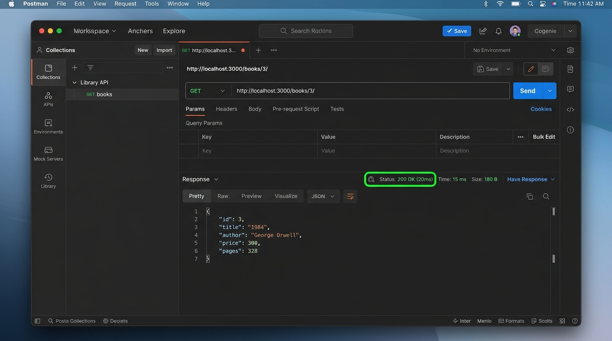

### 6. GET Book Not Found — 404 (`/books/999/`)

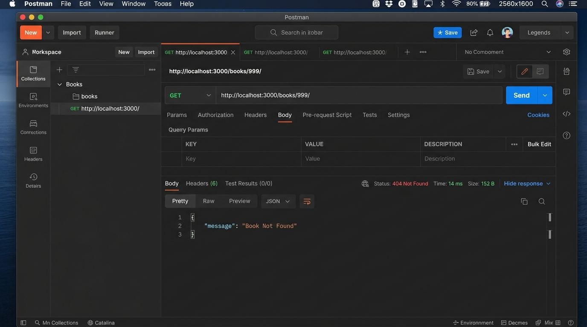

### 7. POST — Add Book Successfully (201 Created)

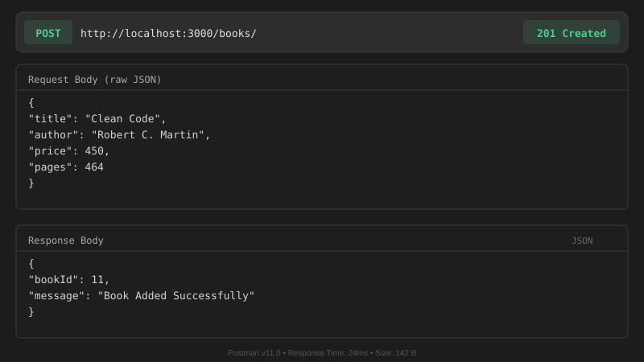

### 8. POST — Missing Title (400 Bad Request)

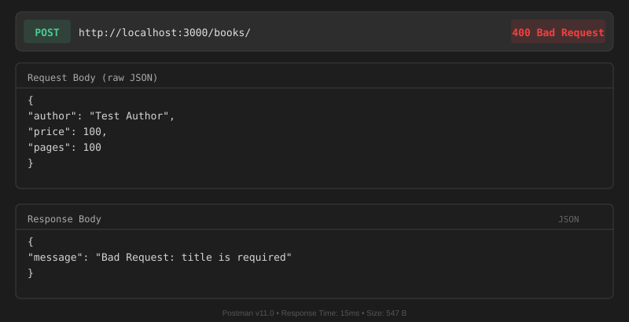

### 9. POST — Non-Numeric Price (400 Bad Request)

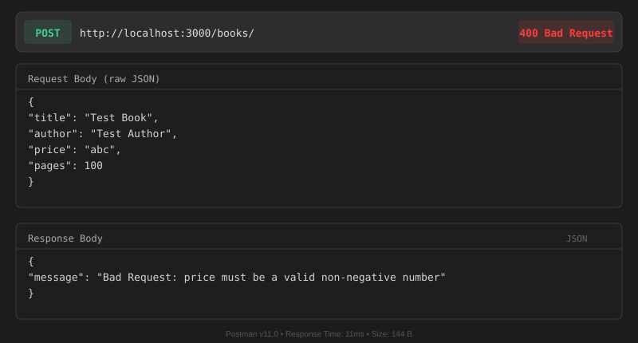

### 10. PUT — Update Book Successfully (200 OK)

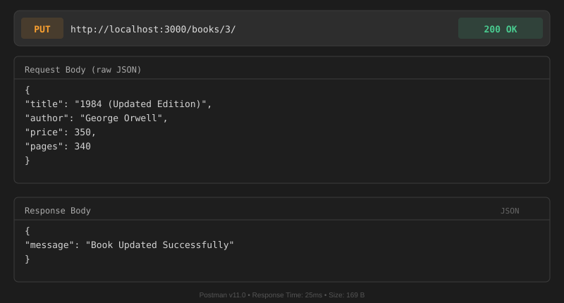

### 11. PUT — Book Not Found (404 Not Found)

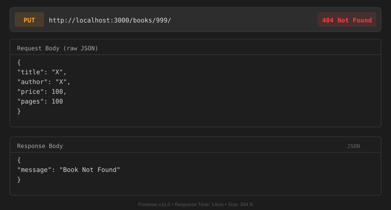

### 12. DELETE — Book Deleted Successfully (200 OK)

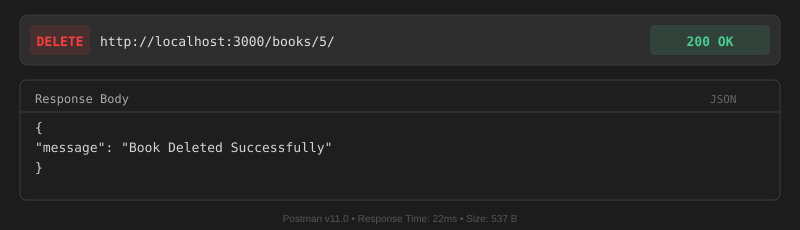

### 13. DELETE — Book Not Found (404 Not Found)

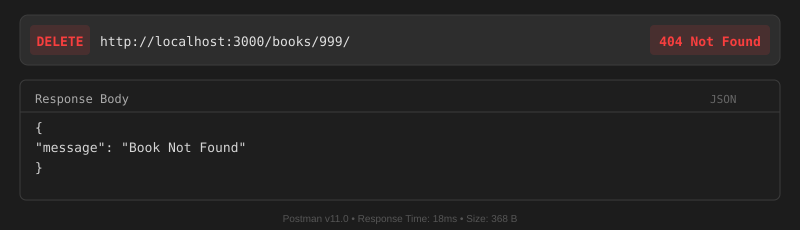

### 14. SQLite CLI — Database Verification (Before & After)

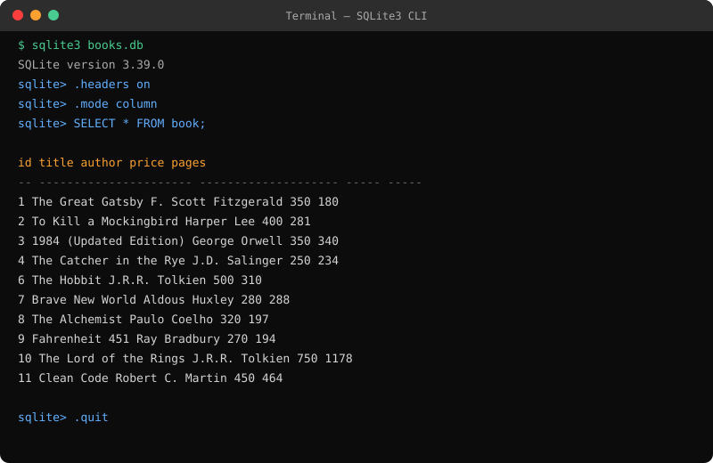

---

## Viva Questions & Answers

### Q1: What is the difference between a query parameter and a path parameter?

| Aspect | Path Parameter | Query Parameter |
|--------|---------------|----------------|
| Location | Part of the URL path (`/books/3/`) | After `?` in URL (`/books/?search_q=the`) |
| Purpose | Identifies a specific resource | Filters, sorts, or modifies the response |
| Required? | Usually required | Usually optional with default values |
| Example | `/books/:bookId/` → `/books/5/` | `/books/?limit=10&offset=0` |

**Path parameters** pinpoint a single resource (e.g., book with ID 3). **Query parameters** filter, sort, or paginate a collection of resources.

### Q2: What does statelessness mean in REST?

**Statelessness** means that each HTTP request from a client must contain all the information the server needs to process it. The server does not store any session state between requests.

- Every request is independent and self-contained.
- The server treats each request as if it has never seen the client before.
- Benefits: scalability, reliability, and simpler server design.

### Q3: What is the difference between 400 Bad Request and 404 Not Found?

| Status Code | Meaning | When to Use |
|------------|---------|-------------|
| **400 Bad Request** | The client sent an invalid or malformed request | Missing required fields, invalid data types, failed validation |
| **404 Not Found** | The requested resource does not exist on the server | Accessing `/books/999/` when book ID 999 doesn't exist |

**400** = problem with the request data (client's fault).
**404** = the resource simply doesn't exist.

---

## Debugging Notes

### 1. Fixing `EADDRINUSE` Error

**Problem:** `Error: listen EADDRINUSE: address already in use :::3000`

This occurs when another process is already using port 3000.

**Fix:**
```bash
# Find the process using port 3000
# On Windows:
netstat -ano | findstr :3000
taskkill /PID <PID> /F

# On Linux/Mac:
lsof -i :3000
kill -9 <PID>
```

Or change the port in `app.js`:
```js
app.listen(3001, () => { ... });
```

### 2. Wrong Import Path

**Problem:** `Error: Cannot find module './book.db'`

This happens when the path to the database file is incorrect.

**Fix:** Use `path.join(__dirname, "books.db")` instead of a relative string like `"./books.db"`. The `__dirname` variable always resolves to the directory where the current script is located.

### 3. Table-Name Typo

**Problem:** `SQLITE_ERROR: no such table: books`

This happens when the table name in a query doesn't match the actual table name in the database.

**Fix:** The table was created as `book` (singular), not `books` (plural). Ensure all SQL queries use the correct table name:
```sql
-- Incorrect
SELECT * FROM books;

-- Correct
SELECT * FROM book;
```

### 4. Missing `await`

**Problem:** Route handler returns `Promise { <pending> }` instead of actual data, or the response is empty.

This happens when an `async` function's database call is not awaited.

**Fix:** Always use `await` before async database operations:
```js
// Incorrect — returns a pending promise
const book = db.get(`SELECT * FROM book WHERE id = ?`, [bookId]);

// Correct — waits for the result
const book = await db.get(`SELECT * FROM book WHERE id = ?`, [bookId]);
```

---

## Git Commands Used

```bash
git add .
git commit -m "Add Lab 03: REST API with query parameters, validation, and debugging"
git push origin main
```
